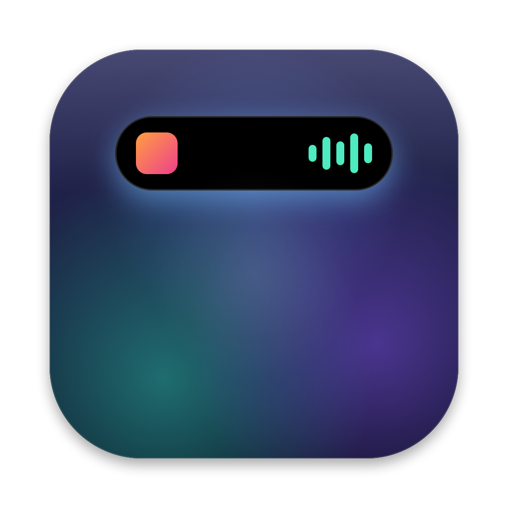

<p align="center"></p>

# IslandBar

A native, open-source Dynamic Island–style utility for macOS, built with Swift 6, SwiftUI and AppKit.

On a MacBook with a notch, IslandBar wraps the notch with a compact island that expands into an
interactive panel. On external displays and Macs without a notch, it shows a virtual island at
the top of the screen.

IslandBar is local-first: no account, no cloud service, no telemetry, no analytics. Nothing is
accessed until you turn it on. See the [Privacy Statement](PRIVACY.md).

## Features

| Module | What it does |
| --- | --- |
| **Media** | Track, artist, artwork, progress and controls for **Music** and **Spotify**, plus (opt-in) YouTube, SoundCloud and other web players in **Chrome, Safari, Edge and Brave**. |
| **File Shelf** | Drop files on the island to park them. Thumbnails, drag back out, copy, reveal, auto-expiry. Stores references, never copies. |
| **Focus** | Pomodoro timer with custom durations, long breaks, session counter and quick notes. Survives restarts and sleep. |
| **System Monitor** | CPU, memory, network, disk, battery and optional GPU utilisation, sampled only while visible. |
| **Developer** | Branch, changes and ahead/behind for Git repositories you choose, plus build/test/agent progress from your own tools. |
| **Camera & Mic** | Shows when any app is using the camera or microphone, naming the app using the microphone. No permission needed. |
| **Mirror** | A quick camera preview for checking yourself before a call. The camera only runs while you are looking at it. |
| **Sound** | Per-app volume (0–150%), mute, and a six-band equaliser with presets. Opt-in; uses Core Audio process taps (macOS 14.2+). |
| **Bluetooth Devices** | Banners when headphones, speakers, keyboards, mice and trackpads connect or disconnect; battery levels and low-battery alerts where devices report them. No permission needed. |
| **Keep Awake** | Keep your Mac awake for 15 minutes to indefinitely, from the island header or the menu bar. |
| **Activity** | Banners and a history of IslandBar's own events, optionally mirrored to Notification Center. |

The island also supports:

- **Interaction:** hover to expand, click to keep it open, Escape to close, and a global shortcut (⌃⌥Space by default).
- **Appearance:** six themes (Midnight Black, Liquid Glass, Frosted Glass, Minimal Dark, Minimal Light and Custom) and configurable size, shape and animations.
- **Accessibility:** it follows Reduce Motion.
- **Displays:** a per-display on/off setting.

### Known limitations

- **Media support is per player.** macOS has no public API for system-wide "Now Playing" information.
  - **Supported:** Music, Spotify, and media sites in Chrome, Safari, Edge and Brave.
  - **Browser setup:** browser support is off by default. Each browser needs a one-time setting, "Allow JavaScript from Apple Events".
  - **Not supported:** Firefox, Arc and other apps.

  See [docs/PERMISSIONS.md](docs/PERMISSIONS.md#media).
- **Other apps' notifications are not shown.** IslandBar cannot read them.
- **No temperatures.** There is no public API for GPU or CPU temperatures.

## Requirements

- macOS 14 Sonoma or later (Apple Silicon and Intel)
- To build: Xcode 16 or later (Swift 6). No paid Apple Developer membership is needed.

## Build and run

```sh
scripts/build-app.sh            # debug  -> build/debug/IslandBar.app
scripts/build-app.sh release    # release -> build/release/IslandBar.app
open build/debug/IslandBar.app
```

IslandBar lives in the menu bar (no Dock icon). Choose **Settings…** from its menu, or the gear
in the expanded island, to configure it.

```sh
scripts/test.sh                 # run the test suite
```

More detail, including signing and Gatekeeper behaviour, is in [docs/BUILDING.md](docs/BUILDING.md).

## Documentation

- [Architecture](docs/ARCHITECTURE.md): modules, state flow, concurrency
- [Privacy Statement](PRIVACY.md): what IslandBar stores, sends (nothing) and asks for
- [Permissions in detail](docs/PERMISSIONS.md): how each integration works
- [Integrations](docs/INTEGRATIONS.md): sending build, test and agent events from your tools
- [Building](docs/BUILDING.md) and [Releasing](docs/RELEASING.md)
- [Manual test checklist](docs/TESTING.md)
- [Contributing](CONTRIBUTING.md) · [Security](SECURITY.md) · [Code of Conduct](CODE_OF_CONDUCT.md)

## License

MIT. See [LICENSE](LICENSE).
